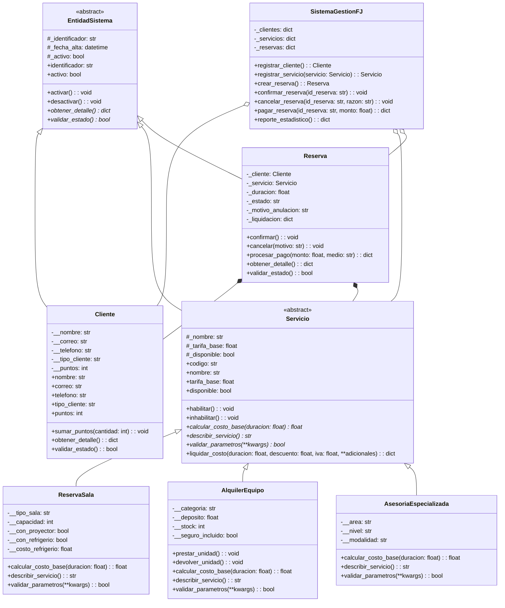

# Sistema Integral de Gestión de Clientes, Servicios y Reservas - Software FJ

**Universidad Nacional Abierta y a Distancia (UNAD)**  
**Escuela de Ciencias Básicas, Tecnología e Ingeniería (ECBTI)**  
**Curso:** Programación (Código 213023) | **Grupo:** 133  
**Actividad:** Fase 4 - Componente práctico (Prácticas simuladas)  
**Estudiante:** Janner Jose Vega Torres | **Año:** 2026  

---

## 1. Descripción del Proyecto

Este proyecto corresponde a la solución práctica del **Ejercicio 1 (Anexo 3)** para la empresa **Software FJ**, una organización dedicada a prestar servicios de:
* **Reserva de salas físicas** (juntas directivas, auditorios y talleres de capacitación).
* **Alquiler de equipos de cómputo y redes** (servidores en rack, portátiles y switches).
* **Asesorías especializadas de TI** (arquitectura cloud, ciberseguridad e inteligencia artificial).

La solución fue desarrollada en **Python** aplicando los principios de la Programación Orientada a Objetos (POO) y **sin utilizar motores de bases de datos**, gestionando la información en memoria con listas y diccionarios, y registrando todos los eventos y errores en un archivo persistente de log (`software_fj.log`).

---

## 2. Características Técnicas de la Solución

* **Abstracción:** Se implementó la clase abstracta `EntidadSistema` (mediante el módulo `abc`) y la clase abstracta `Servicio`, las cuales obligan a implementar métodos para obtener detalles y validar estado.
* **Herencia y Polimorfismo:** Las clases `ReservaSala`, `AlquilerEquipo` y `AsesoriaEspecializada` heredan de `Servicio` y sobrescriben de manera polimórfica los métodos de cálculo de costo (`calcular_costo_base()`), descripción y validación técnica.
* **Encapsulamiento:** La clase `Cliente` protege sus atributos privados (`__nombre`, `__correo`, `__telefono`) mediante decoradores `@property` y `@setter`, validando el formato de correos con expresiones regulares y teléfonos de 10 dígitos puramente numéricos.
* **Sobrecarga de Métodos:** El método `liquidar_costo()` en la clase `Servicio` permite calcular el valor bruto, aplicar descuentos comerciales porcentuales, recargos opcionales y el cálculo del impuesto IVA (19%).
* **Manejo Robusto de Excepciones:**
  * Jerarquía de clases de error derivadas de `SoftwareFJError`: `DatoInvalidoError`, `ServicioNoDisponibleError`, `OperacionNoPermitidaError`, `CalculoInconsistenteError` y `ReservaInvalidaError`.
  * Uso de estructuras `try/except`, `try/except/else` y `try/except/finally`.
  * **Encadenamiento de excepciones (`raise ... from`):** Captura de `ValueError` al validar teléfonos y reenvío como `DatoInvalidoError` conservando la causa en `__cause__`.
* **Registro de Auditoría (Logging):** Configuración del módulo `logging` con salida dual a consola y al archivo `software_fj.log`.

---

## 3. Diagrama de Clases UML



---

## 4. Estructura de Archivos del Proyecto

```text
Fase4_Sistema_SoftwareFJ/
├── software_fj.py                      # Código principal del sistema y simulación
├── test_software_fj.py                 # Pruebas unitarias automatizadas con pytest
├── software_fj.log                     # Archivo de auditoría generado en tiempo real
├── Fase4_Documento_Final_Janner_Vega.pdf # Informe formal en PDF (Normas APA 7ma edición)
├── generar_informe_pdf.py              # Script en ReportLab para compilar el informe PDF
└── README.md                           # Documentación técnica del proyecto
```

---

## 5. Instrucciones de Ejecución

### Prerrequisitos
* Tener instalado Python 3.10 o superior.

### Para ejecutar el programa principal y ver la simulación:
```bash
py software_fj.py
# O en otros sistemas operativos:
python software_fj.py
```

### Para correr las pruebas unitarias:
```bash
py -m pytest test_software_fj.py -v
```

### Para consultar el archivo de logs:
* En Windows PowerShell:
  ```powershell
  Get-Content software_fj.log -Tail 25
  ```
* En Linux o macOS:
  ```bash
  tail -n 25 software_fj.log
  ```

---

## 6. Resumen de Pruebas Simuladas (11 Casos)

1. **Registro de cliente corporativo (Válido):** Crea el cliente y lo indexa en memoria.
2. **Validación de correo (Inválido):** Captura `DatoInvalidoError` al ingresar correo sin `@`.
3. **Validación de teléfono (Inválido):** Demuestra `raise ... from` capturando `ValueError` y guardando la causa original en `__cause__`.
4. **Creación de sala (Válido):** Registra auditorio con capacidad de 80 personas y refrigerio.
5. **Tarifa negativa (Inválido):** Captura `CalculoInconsistenteError` en el constructor del servicio.
6. **Creación de hardware y consultoría (Válido):** Incorpora servidor en rack y asesoría técnica.
7. **Reserva con try/except/else (Válido):** El bloque `else` liquida la reserva aplicando 10% de descuento corporativo e IVA del 19%.
8. **Reserva de equipo sin stock (Inválido):** Captura `ServicioNoDisponibleError` cuando el stock llega a 0.
9. **Cancelación duplicada con try/except/finally (Inválido):** Captura `OperacionNoPermitidaError` y el bloque `finally` comprueba el estado de memoria.
10. **Duración negativa (Inválido):** Captura `CalculoInconsistenteError` al pasar `-3.0` horas de reserva.
11. **Flujo completo y pago (Válido):** Registra cliente natural, crea reserva, confirma, procesa pago por PSE y acumula puntos de fidelidad.

---

## 7. Autor y Créditos

* **Estudiante:** Janner Jose Vega Torres
* **Grupo:** 133
* **Universidad:** Universidad Nacional Abierta y a Distancia (UNAD)
* **Curso:** Programación (213023)
* **Periodo:** 2026
